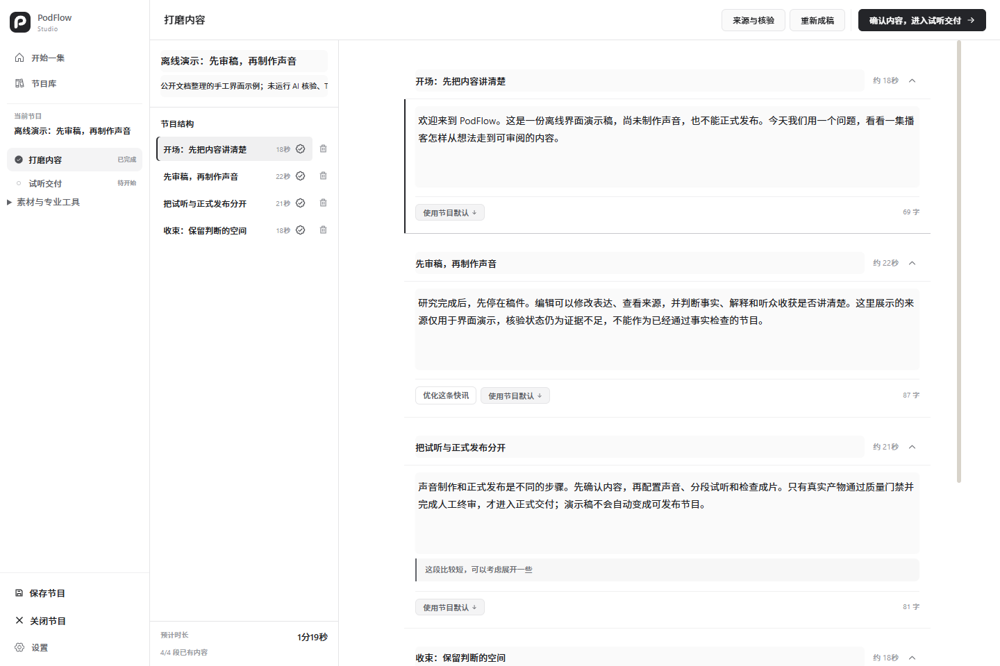
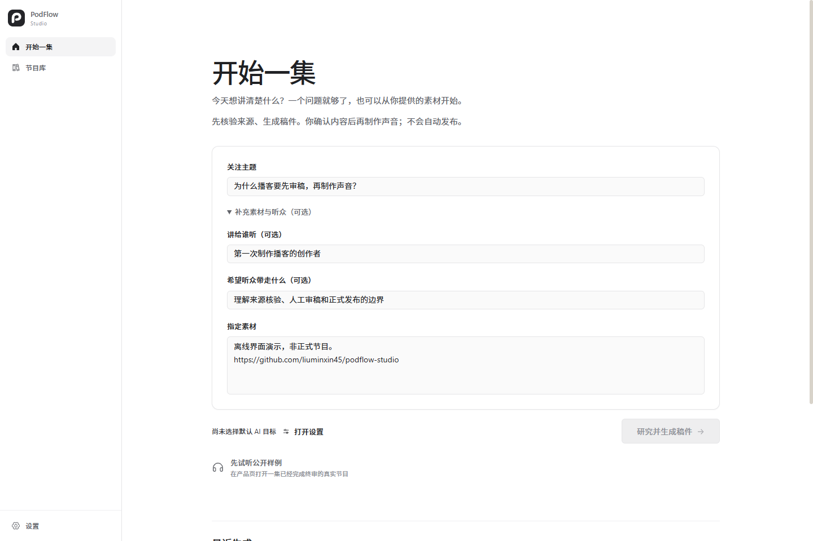
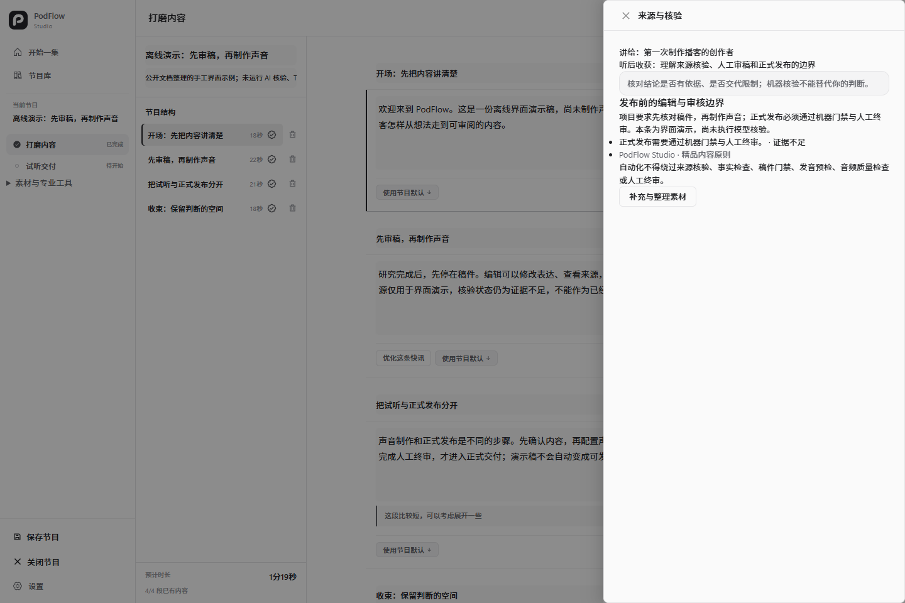
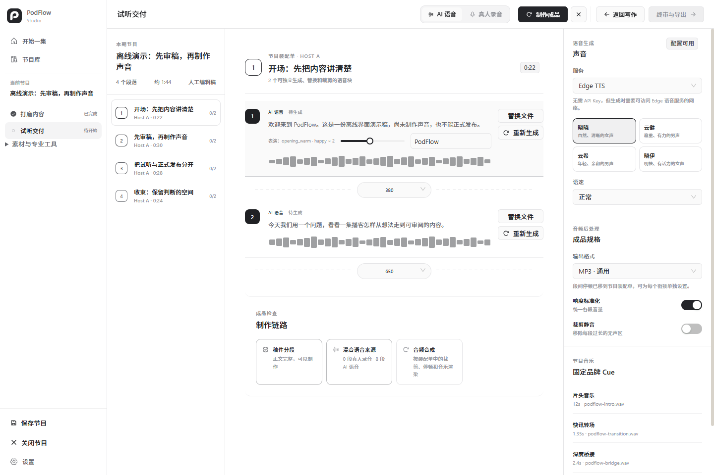

<div align="center">



# PodFlow Studio

**本地优先的 AI 新闻播客制作工作台**

从一个问题或一组素材开始，研究并生成稿件，核对内容后再制作声音，完成终审后导出节目。

**PodFlow Studio 支持 AI 驱动的全流程自动化，但自动化不以牺牲内容质量为代价。只有通过来源核验、编辑门禁、声音质检与人工终审的内容，才能进入正式发布。**

[产品介绍](https://www.liuminxin.cn/works/podflow-studio) · [站内试听](https://www.liuminxin.cn/works/podflow-studio#episode-player) · [订阅 RSS](https://www.liuminxin.cn/podflow-studio/feed.xml) · [下载 Windows 0.2.0](https://github.com/liuminxin45/podflow-studio/releases/tag/0.2.0) · [查看源码](https://github.com/liuminxin45/podflow-studio)

</div>

## PodFlow Studio 是什么

制作一期新闻播客，需要收集来源、核对事实、写稿、配音，再装配音频和准备发布。PodFlow Studio 面向独立创作者和小型编辑团队，把这些步骤放进一个可检查、可编辑、可恢复的桌面工作台。

默认创作流程是 **开始一集 → 打磨内容 → 试听交付**。素材先整理成事实卡片，再生成可编辑的口播稿，保存后停止；你核对事实、修改表达并确认内容，再制作声音。来源证据与 AI 补充知识分开呈现，正式发布始终保留人工终审。

晨报专业模板面向 `PodFlow 晨报` 的“6 条快讯 + 1 条重点解读”；默认创作入口按实际证据安排篇幅，不凑条数或时长。节目结构与音频要求见 [晨间新闻写作手册](docs/editorial/morning-news-writing-playbook.md) 和 [晨报音频生产规范](docs/morning-news-audio-spec.md)。

任何来源不足、事实检查未完成、稿件未通过门禁、发音未确认、音频质量不合格或缺少人工终审的节目，都必须保留真实原因并阻断正式发布。自动化负责减少重复劳动，编辑仍对内容负责。

```text
发现素材 → 整理与研究 → 事实卡片 → 口播稿 → 配音 / 录音 → 音频成片 → RSS / 发布包
```

## 真实界面

以下截图于 **2026-10-26** 从当前源码工作区启动的 Electron 应用直接捕获，统一为 1440 × 960，未重绘或修改界面。主图展示「打磨内容」。截图包含当时工作区的图标和侧栏样式，不代表已发布的 0.2.0 安装包界面。

截图使用独立本地会话和基于项目公开文档手工整理的演示稿，不含私人节目或密钥。未调用外部 AI、搜索、TTS，也未制作音频或执行正式发布；「证据不足」「待生成」等状态按实际保留。界面中的预计时长与占位波形不代表真实音频结果。

### 开始一集

输入想讲清楚的问题，按需补充素材、听众和听后收获。首次使用需要先配置 AI 成稿目标；声音服务可在审稿后配置。



### 打磨内容

按段编辑口播稿，检查节目结构，并展开「来源与核验」核对证据和主张状态。下图中的主张尚未执行模型核验，明确显示「证据不足」。



### 试听交付

内容确认后，分段制作 AI 语音或替换为真人录音，再装配成片。图中语音块仍为「待生成」，终审与导出尚不可用。



## 核心能力

- **素材与研究**：采集 RSS、网页、手动笔记及聚合源内容，整理候选选题、补充背景，保留可追踪来源。
- **事实驱动写作**：先形成事实卡片，再生成口播稿；编辑可核对来源与逐条主张，修改后的稿件优先用于配音。
- **分段声音制作**：按语音块生成、试听和替换 AI 语音，也可使用真人录音；正式晨报的声音与表演要求见 [音频规范](docs/morning-news-audio-spec.md)。
- **成片与交付**：装配语音和品牌音乐，检查音频质量，完成人工终审后导出节目音频、RSS、元数据和运行报告。
- **本地工作流**：节目与中间产物保存在本机。外部模型、搜索和语音服务按需配置；离线 demo 可验证本地链路，但不产生可正式发布的节目。
- **CLI 与 Agent**：通过隔离会话、机器可读状态、日志和验收入口运行与检查流程，详见 [CLI 参考](docs/cli.md)。

## 安装

### Windows 安装包

从 [GitHub Releases](https://github.com/liuminxin45/podflow-studio/releases/tag/0.2.0) 下载 0.2.0 的 `.exe` 安装程序。安装包功能以 [0.2.0 发布说明](docs/releases/0.2.0.md) 为准；本文截图与三个创作入口说明对应当前源码。当前安装包尚未进行商业代码签名，Windows SmartScreen 可能显示发布者提示。

### 从源码运行

#### 环境要求

- Node.js 22
- Python 3.13
- Windows 10 / 11（当前主要桌面开发与验证环境）

`npm install` 会按当前平台安装 PodFlow 使用的 FFmpeg，无需另外配置系统 FFmpeg。Python 依赖仍由 `npm run setup:python` 安装到项目 `.venv`。

```bash
git clone https://github.com/liuminxin45/podflow-studio.git
cd podflow-studio
npm install
npm run setup:python
npm run cli -- doctor
npm run dev
```

首次启动后，在「设置」中配置实际要使用的模型、搜索和语音服务。你不需要一次配置所有 Provider；只配置当前工作流需要的服务即可。

## 最快上手

桌面端启动后默认进入「开始一集」。配置 AI 成稿目标后即可开始，声音服务可以稍后配置：

1. 输入想讲清楚的问题，或粘贴公开网页链接、素材文字；
2. 可选填写讲给谁听、希望听众带走什么；
3. 研究并生成稿件，核对内容与来源后再制作声音。

点击「研究并生成稿件」后，系统收集素材、研究、选题和核验事实，保存稿件后停止。
「打磨内容」中编辑口播稿、展开来源核对；确认后进入「试听交付」，制作声音、终审并导出。
不会自动发布；未通过质量门禁或尚未人工终审的音频不能正式发布。
详细行为见 [创作入口使用说明](docs/quick-briefing.md)。

如果想先确认完整链路是否可用，运行离线 demo：

```bash
npm install
npm run setup:python
npm run demo:news
```

这条路径不依赖外网、LLM Key 或 TTS Key。没有真实 TTS 时会生成 mock WAV，再由 npm 安装的 FFmpeg 完成音频处理并输出 `final.mp3`。这些是离线验收产物，不代表真实配音或通过正式发布门禁的节目，不能直接用于正式发布。若 npm 安装不完整，流程会明确失败并报告缺失的运行时依赖。

运行完成后，主要结果位于 `examples/demo-news/output/`：

```text
facts.json                 # 结构化事实卡片
script.generated.json      # AI / deterministic 生成稿
script.edited.json         # 可人工编辑的最终稿
final.mp3 或 final.wav      # 成片音频
feed.xml                   # RSS feed
run_report.json            # 运行结果、告警与降级信息
dist/episodes/<episode_id> # 完整发布包
```

## 使用方式

桌面端围绕三个主入口展开，专业功能按需打开：

1. **开始一集**：从一个问题或一组素材生成可审阅稿件。
2. **打磨内容**：编辑口播稿，按需核对来源、事实与听众收获。
3. **试听交付**：分段制作、试听、替换声音，完成终审后导出。
4. **次级入口**：节目库、来源整理、栏目管理、RSS 和设置。

底层继续使用 `morning_news_brief` 的单人口播结构。晨报专业模板保留“6 条快讯 + 1 条重点解读”的写作建议；默认创作入口按实际证据安排篇幅，不凑条数或时长。正式交付仍必须通过来源、事实、稿件、发音、音质及人工终审门禁。

## CLI 与 AI Agent

PodFlow CLI 为人工操作和 AI Agent 提供同一套进程控制与验收入口。每个会话拥有隔离的数据、Electron profile、日志和验收产物；CDP 只绑定本机回环地址。

```bash
npm run cli -- doctor --json
```

从源码部署 CLI 可在 Windows 运行 `powershell -ExecutionPolicy Bypass -File scripts/setup-local.ps1`。它会安装锁定依赖并运行环境诊断，但不会读取或保存任何 API Key。

正式候选节目也能从素材发现开始完全由 CLI 生成。该路径强制使用可追踪证据、实际
LLM 成稿和正式 TTS，并在机器门禁通过后等待绑定最终 MP3 SHA256 的人工终审。命令、
验收、生产阶段和 GitHub Actions 配置见 [CLI 参考](docs/cli.md)；当前声音、混音和审核
门禁见 [晨报音频生产规范](docs/morning-news-audio-spec.md)。

### 音乐与授权

正式品牌 cue 派生自 HoliznaCC0 的 [Make Funk](https://freemusicarchive.org/music/holiznacc0/bassic/make-funk/)，曲目页明确标注 CC0 1.0 与纯音乐。项目保存原始 SHA256、取得日期、裁剪区间与派生文件指纹。素材经裁剪、淡入淡出和响度处理，第三方音乐仍为 CC0，不改写为 Apache-2.0。完整记录见 [音频权利文件](assets/audio/RIGHTS.md)。

全部贡献者与使用者文档见 [文档索引](docs/README.md)。

## 关键设计

### 事实卡片，而不是素材拼接

`FactCard` 是来源与稿件之间的事实层，保存可追踪证据和逐主张核验结果。正式新闻段需要绑定事实及已支持的主张；来源不足或存在冲突时，应先补充核验，不能把完整的界面或已填写的稿件视为通过审核。

### 人工编辑稿优先

系统同时保留生成稿和 `edited_script`。一旦存在人工编辑稿，TTS 和后续制作链路会优先使用它，避免重新生成覆盖已经确认的表达。

### 可解释的降级

外部模型不可用时，只能产生标记为 `demo_only` 的诊断产物，并把真实原因写入 `run_report.json`；不会降级成可发布结果。FFmpeg 是由 npm 管理的必需运行时，缺失时会明确失败。

### 本地预览与公网发布分离

机器门禁全部通过但尚未人工终审时，可用 `package --preview-only` 生成内部预览，目录固定为 `out/previews/<episode>/<audio-sha-prefix>/`。预览不生成 RSS、公开 URL 或正式发布目录；人工终审通过且与当前 MP3 SHA256 匹配后，才允许正式打包与发布。

### 导出与发布公开节目包

正式候选节目通过 `podflow produce` 生成与渲染，机器门禁通过后，仍需绑定当前 MP3 SHA256 的人工终审。正式发布包只消费绑定当前音频的 `publish_ready` 状态，音频指标来自真实产物。阶段、固定资产与发布配置见 [CLI 参考](docs/cli.md)。

仓库维护者的公开晨报通过独立的 [podflow-morning-feed](https://github.com/liuminxin45/podflow-morning-feed) 仓库托管音频，并由个人主页提供试听和订阅。该部署需要单独配置，不是安装桌面端后自动获得的托管服务。

## 配置

桌面端「设置」可以管理常用配置；仓库中的 `config.example.yaml` 展示了完整配置结构。密钥请放在本地环境或桌面端配置中，不要写入仓库。

当前可接入的能力包括：

- 由 Python / Pydantic AI Agent 统一执行的 OpenAI、Anthropic、Gemini、OpenRouter、Ollama 与 DeepSeek
- Codex、Claude Code 等已配置的本地 CLI Agent
- Edge TTS 与 OpenAI-compatible TTS
- RSS / 网页内容源
- AI News Daily 与 NewsNow 聚合源
- 可选搜索服务与人工笔记

## 开发与验证

```bash
npm run dev             # 启动 Vite + Electron 开发环境
npm run lint            # 检查 TypeScript、React 与脚本
npm run lint:py         # 检查 Python
npm run build           # TypeScript 检查并构建前端
npm run test:run        # 运行前端测试
npm run verify:offline  # 运行无需外部服务的校验
npm run demo:news       # 运行端到端离线示例
npm run acceptance:cdp # 运行隔离的 Electron/CDP 主路径验收
```

项目主要由 Electron、React、TypeScript 和 Python 组成。React 只提交类型化 AI 任务；Electron 负责凭据边界、Python Gateway 生命周期、IPC 和取消传播；Python 的 Agent Registry 与 Pydantic AI Runtime 是唯一 AI 执行中心。跨进程只传 PodFlow JSON 契约，不公开任意 Prompt/messages 接口。

## 当前边界

PodFlow Studio 当前优先保证“单人新闻早报”的完整闭环。以下方向仍属于次要或实验能力：

- 多主持人节目
- 长篇故事型播客
- 无人工终审的正式云端发布
- 真实 TTS Provider 在所有网络环境下的生产级稳定性

它不是通用音频剪辑器、新闻 CMS 或海量数据源聚合平台。产品目标是让创作者用一条可检查、可编辑、可恢复的流程稳定完成节目。

## 开源协议

PodFlow Studio 采用 [Apache License 2.0](LICENSE)，对应 SPDX 标识为
`Apache-2.0`。项目归属信息见 [NOTICE](NOTICE)；第三方依赖与素材仍遵循各自许可证。
